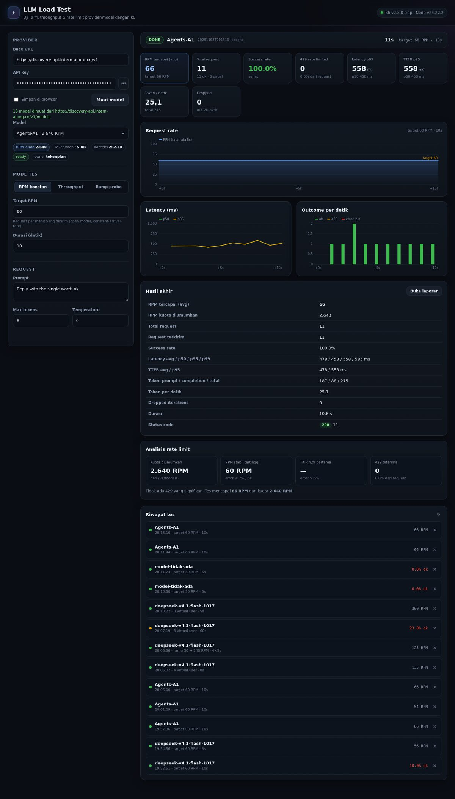

# LLM Load Test

Dashboard web untuk menguji **RPM (requests per minute)**, throughput, latency, dan **rate limit** sebuah provider/model LLM menggunakan [k6](https://k6.io). Mendukung endpoint yang kompatibel dengan OpenAI (`/chat/completions`).

[](https://k6.io)
[](https://nodejs.org)
[](LICENSE)
[](#instalasi-satu-perintah)



---

## Daftar isi

- [Fitur](#fitur)
- [Instalasi satu perintah](#instalasi-satu-perintah)
  - [Ubuntu / Debian](#ubuntu--debian)
  - [Windows 10 / 11](#windows-10--11)
- [Cara pakai](#cara-pakai)
- [Mode pengujian](#mode-pengujian)
- [Metrik yang diukur](#metrik-yang-diukur)
- [Akses dari internet](#akses-dari-internet)
- [Konfigurasi](#konfigurasi)
- [Instalasi manual](#instalasi-manual)
- [API](#api)
- [Struktur project](#struktur-project)
- [Keamanan](#keamanan)
- [Troubleshooting](#troubleshooting)
- [Batasan](#batasan)
- [Lisensi](#lisensi)

---

## Fitur

- **Auto-discover model** dari `GET /v1/models`, termasuk kuota RPM/TPM yang diumumkan provider (bila tersedia).
- **Tiga mode uji**: RPM konstan, throughput (VU), dan ramp probe untuk menemukan titik `429`.
- **Metrik live via SSE**: RPM saat ini, RPM rata-rata, success rate, p50/p95 latency, TTFB, 429, token/detik, dropped iterations, VU aktif.
- **Grafik live**: request rate, latency p50/p95, dan outcome per detik (ok / 429 / error lain).
- **Analisis rate limit**: kuota yang diumumkan vs RPM stabil tertinggi vs titik 429 pertama.
- **Riwayat run** tersimpan di disk + **laporan HTML mandiri** per run.
- **Pesan error provider** (mis. body 429/404) ikut ditampilkan.
- **Basic Auth** opsional, aktif otomatis lewat installer.
- **Tanpa dependency npm** — hanya Node.js + k6.

---

## Instalasi satu perintah

Installer akan melakukan semuanya: memasang Node.js (bila perlu), memasang k6 (bila perlu), menyalin aplikasi, membuat password Basic Auth, dan menjalankan dashboard sebagai service.

### Ubuntu / Debian

**Opsi A — langsung dari internet (paling cepat):**

```bash
curl -fsSL https://raw.githubusercontent.com/keplia/llm-loadtest/main/install.sh | sudo bash
```

**Opsi B — clone lalu install:**

```bash
git clone https://github.com/keplia/llm-loadtest.git
cd llm-loadtest
sudo ./install.sh
```

Setelah selesai, installer mencetak alamat dan kredensial login, misalnya:

```
  Lokal   : http://localhost:8787
  Jaringan: http://10.0.0.5:8787
  Login   : admin / Xy7kQ2mP9aZc
```

Opsi installer:

```bash
sudo ./install.sh --port 9000          # ganti port
sudo ./install.sh --no-auth            # tanpa Basic Auth (tidak disarankan)
sudo ./install.sh --dir /srv/llmtest   # ganti folder instalasi
sudo ./install.sh --uninstall          # lepas service (data tetap)
sudo ./install.sh --uninstall --purge  # hapus service + data
```

Service systemd otomatis aktif dan jalan lagi setelah reboot:

```bash
systemctl status llm-loadtest
journalctl -u llm-loadtest -f
```

### Windows 10 / 11

Buka **PowerShell** (tidak perlu Administrator, kecuali memakai `-AddFirewallRule`).

**Opsi A — unduh lalu jalankan:**

```powershell
irm https://raw.githubusercontent.com/keplia/llm-loadtest/main/install.ps1 -OutFile install.ps1
powershell -ExecutionPolicy Bypass -File .\install.ps1
```

**Opsi B — clone lalu install:**

```powershell
git clone https://github.com/keplia/llm-loadtest.git
cd llm-loadtest
powershell -ExecutionPolicy Bypass -File .\install.ps1
```

> Setelah clone, kamu juga bisa **double-click `install.cmd`** untuk menjalankan installer tanpa mengetik perintah.

Installer akan:

1. Memasang **Node.js 22 LTS** via `winget`, atau mengunduh installer resmi bila `winget` tidak ada.
2. Memasang **k6** via `winget`, atau mengunduh rilis resmi dari GitHub.
3. Menyalin aplikasi ke `%LOCALAPPDATA%\llm-loadtest`.
4. Membuat password Basic Auth acak di `.auth.env`.
5. Membuat `start.cmd`, `start.ps1`, dan shortcut **LLM Load Test** di Desktop.
6. Menjalankan dashboard dan membuka browser.

Opsi installer:

```powershell
.\install.ps1 -Port 9000
.\install.ps1 -AutoStart            # otomatis jalan saat login (Scheduled Task)
.\install.ps1 -AddFirewallRule      # buka port di Windows Firewall (butuh admin)
.\install.ps1 -NoAuth               # tanpa Basic Auth
.\install.ps1 -Uninstall            # hapus scheduled task (data tetap)
.\install.ps1 -Uninstall -Purge     # hapus task + folder aplikasi
```

Menjalankan lagi nanti: buka shortcut **LLM Load Test** di Desktop, atau:

```powershell
cd "$env:LOCALAPPDATA\llm-loadtest"
.\start.cmd
```

> **Catatan:** Windows Defender SmartScreen bisa memperingatkan karena script diunduh dari internet. Pilih **More info → Run anyway**, atau jalankan lewat `powershell -ExecutionPolicy Bypass -File`.

---

## Cara pakai

1. Isi **Base URL** (contoh `https://api.openai.com/v1`) dan **API key**.
2. Klik **Muat model**. Daftar model muncul beserta kuota RPM-nya (jika provider menyediakannya).
3. Pilih mode dan target:
   - **RPM konstan** — isi target RPM + durasi.
   - **Throughput** — isi jumlah VU + durasi.
   - **Ramp probe** — isi RPM awal/akhir, jumlah step, dan detik per step.
4. Atur prompt, `max_tokens`, dan temperature. Untuk pengujian RPM, pakai `max_tokens` kecil agar request cepat.
5. Klik **Mulai tes**. Hasil live tampil; setelah selesai, ringkasan + analisis rate limit muncul dan laporan HTML bisa dibuka.

### Tips pengujian yang valid

- Gunakan `max_tokens` kecil (8–32) dan prompt pendek agar yang diukur benar-benar rate limit, bukan waktu generasi.
- Uji **RPM konstan** sedikit di bawah kuota, lalu naikkan bertahap untuk melihat titik `429`.
- `Pre-allocated VUs = 0` berarti otomatis (`RPM/60 × 3 detik`). Jika `dropped iterations` > 0 atau VU aktif mentok di `max VUs`, naikkan **Max VUs**.
- Rate limit provider biasanya dihitung **per menit** dan **berbagi kuota dengan request lain** (termasuk tes sebelumnya). Beri jeda antar tes.
- Aktifkan **Prompt unik tiap request** bila provider melakukan caching, supaya hasil tidak bias.
- Gunakan **no keep-alive** hanya jika ingin mengukur biaya handshake; default keep-alive lebih realistis.

---

## Mode pengujian

| Mode | Executor k6 | Kegunaan |
| --- | --- | --- |
| **RPM konstan** | `constant-arrival-rate` | Mengirim request pada laju RPM tetap (open model). Paling akurat untuk menguji kuota RPM. |
| **Throughput** | `constant-vus` | Mengukur berapa RPM yang bisa dicapai dengan N koneksi paralel. Bisa jauh melewati kuota dan memicu banyak 429. |
| **Ramp probe** | `ramping-arrival-rate` | Rate naik bertahap untuk menemukan titik provider mulai menolak (`429`). |

> Untuk mencari batas RPM, **Ramp probe** atau **RPM konstan bertahap** lebih informatif daripada mode Throughput.

---

## Metrik yang diukur

| Metrik | Sumber | Arti |
| --- | --- | --- |
| RPM saat ini | `request_starts` (10 detik terakhir) | Laju pengiriman request aktual |
| RPM rata-rata | `request_starts` ÷ durasi | Rata-rata laju pengiriman |
| Success rate | status HTTP | Persentase respons 2xx |
| Latency p50/p95/p99 | `http_req_duration` | Waktu total request |
| TTFB | `http_req_waiting` | Waktu sampai byte pertama |
| 429 | `http_req_failed` + status | Jumlah request yang ditolak rate limit |
| Token/detik | `usage` respons | Throughput token |
| Dropped iterations | `dropped_iterations` | Iterasi gagal dijadwalkan karena VU habis |
| RPM stabil tertinggi | analisis jendela | Rate tertinggi dengan error ≤ 2% |
| Titik 429 pertama | analisis jendela | Rate saat error/429 > 5% |

> `RPM tercapai` dihitung dari jumlah request **yang benar-benar dikirim** dibagi durasi jadwal tes, sehingga tidak terdistorsi oleh waktu tunggu `gracefulStop` saat request terakhir masih berjalan.

---

## Akses dari internet

Server default mendengarkan di `0.0.0.0` bila dijalankan lewat installer, tetapi banyak VPS berada di belakang NAT sehingga port tidak bisa dibuka dari internet. Dua opsi tunnel gratis:

### Tailscale Funnel (URL permanen, direkomendasikan)

```bash
curl -fsSL https://tailscale.com/install.sh | sh
tailscale up --hostname=llm-loadtest --accept-dns=false
tailscale funnel --bg --yes 8787
tailscale funnel status
```

Aktifkan Funnel sekali di tautan yang diberikan Tailscale, lalu dashboard tersedia di:

```
https://llm-loadtest.<nama-tailnet>.ts.net
```

HTTPS berasal dari sertifikat asli (ACME), dan konfigurasi bertahan setelah reboot.

### Cloudflare quick tunnel (sementara)

```bash
cloudflared tunnel --url http://127.0.0.1:8787
```

URL `https://<acak>.trycloudflare.com` **berubah** setiap restart. Cocok hanya untuk akses sementara.

> Catatan: k6 berjalan **di mesin yang sama** dengan server, jadi request ke provider LLM tidak melewati tunnel. Tunnel hanya membawa UI/SSE dan tidak memengaruhi hasil tes.

---

## Konfigurasi

| Variabel | Default | Keterangan |
| --- | --- | --- |
| `PORT` | `8787` | Port HTTP |
| `HOST` | `127.0.0.1` | Pakai `0.0.0.0` agar bisa diakses dari luar mesin |
| `K6_BIN` | `k6` | Path binary k6 |
| `AUTH_USER` | _(kosong)_ | Username Basic Auth (opsional) |
| `AUTH_PASS` | _(kosong)_ | Password Basic Auth (opsional) |

Jika `AUTH_USER` dan `AUTH_PASS` diisi, **seluruh** halaman dan API dilindungi HTTP Basic Auth.

Mengganti password:

```bash
# Ubuntu
sudo nano /opt/llm-loadtest/.auth.env
sudo systemctl restart llm-loadtest
```

```powershell
# Windows
notepad "$env:LOCALAPPDATA\llm-loadtest\.auth.env"
# lalu tutup & jalankan ulang start.cmd
```

---

## Instalasi manual

Tanpa installer, cukup Node.js ≥ 20 dan k6 ≥ 0.50.

```bash
git clone https://github.com/keplia/llm-loadtest.git
cd llm-loadtest
npm start                      # http://127.0.0.1:8787
# atau, agar bisa diakses dari mesin lain:
HOST=0.0.0.0 AUTH_USER=admin AUTH_PASS=rahasia npm start
```

Install k6 di Linux:

```bash
curl -sL https://github.com/grafana/k6/releases/download/v2.3.0/k6-v2.3.0-linux-amd64.tar.gz \
  | tar xz --strip-components=1 -C /usr/local/bin k6-v2.3.0-linux-amd64/k6
k6 version
```

Install k6 di Windows:

```powershell
winget install k6.k6
# atau: choco install k6
```

---

## API

| Method | Path | Keterangan |
| --- | --- | --- |
| `GET` | `/api/health` | Status server + versi k6 |
| `POST` | `/api/models` | Proxy `GET {baseURL}/models` |
| `POST` | `/api/runs` | Mulai tes |
| `GET` | `/api/runs` | Riwayat |
| `GET` | `/api/runs/:id` | Metadata + hasil |
| `GET` | `/api/runs/:id/events` | Stream SSE (`snapshot`, `done`) |
| `POST` | `/api/runs/:id/stop` | Hentikan tes (SIGINT ke k6) |
| `GET` | `/api/runs/:id/result` | JSON hasil |
| `GET` | `/api/runs/:id/report` | Laporan HTML |
| `GET` | `/api/runs/:id/log` | Log k6 |
| `DELETE` | `/api/runs/:id` | Hapus run |

Contoh:

```bash
curl -X POST http://127.0.0.1:8787/api/runs \
  -H 'Content-Type: application/json' \
  -d '{
    "baseURL": "https://api.example.com/v1",
    "apiKey": "sk-...",
    "model": "my-model",
    "mode": "arrival",
    "targetRPM": 120,
    "durationSec": 60,
    "maxTokens": 16
  }'
```

---

## Struktur project

```
llm-loadtest/
├── server.js            # HTTP server + REST/SSE API + static files
├── install.sh           # installer Ubuntu/Debian (systemd)
├── install.ps1          # installer Windows (Node + k6 + shortcut/task)
├── install.cmd          # double-click installer untuk Windows
├── start-public.sh      # launcher Linux (HOST=0.0.0.0 + .auth.env)
├── url.sh               # cetak URL publik tunnel yang aktif
├── k6/
│   └── llm.js           # skenario k6 (arrival / vus / ramp)
├── lib/
│   ├── runner.js        # spawn k6, lifecycle run, simpan hasil
│   ├── metrics.js       # agregasi NDJSON → metrik live + analisis limit
│   ├── tail.js          # tail file NDJSON k6
│   └── report.js        # generator laporan HTML
├── public/              # UI (vanilla JS, tanpa build step)
├── docs/                # screenshot
└── runs/                # data tiap run (config, NDJSON, log, hasil)
```

---

## Keamanan

- API key **tidak** dikembalikan ke klien (hanya `hasApiKey: true`).
- API key dibutuhkan k6 saat run, jadi disimpan sementara di `runs/<id>/config.secret.json` dengan permission `600`. File ini tidak pernah disajikan sebagai static file.
- “Simpan di browser” menyimpan API key di `localStorage` (opsional, default mati).
- ID run divalidasi untuk mencegah path traversal.
- Installer membuat password acak dan mengaktifkan Basic Auth secara default.
- Hapus folder `runs/` untuk membersihkan seluruh riwayat dan kredensial tersimpan.
- **Jangan** mengekspos dashboard tanpa Basic Auth ke internet publik.

---

## Troubleshooting

| Gejala | Penyebab & solusi |
| --- | --- |
| `k6 tidak ditemukan` | k6 tidak ada di `PATH`. Jalankan `k6 version`, atau set `K6_BIN=/path/ke/k6`. |
| `dropped iterations` > 0 | VU tidak cukup. Naikkan **Max VUs** atau `Pre-allocated VUs`. |
| Hampir semua respons `429` | Target melewati kuota, atau kuota sedang terpakai tes lain. Tunggu 1 menit, turunkan RPM, atau pakai mode Ramp. |
| Angka RPM rendah padahal target tinggi | Latency provider tinggi sehingga VU habis. Lihat `dropped` dan VU aktif. |
| `EADDRINUSE` | Port sudah dipakai. Ganti `--port` / `PORT`. |
| Windows: `running scripts is disabled` | Jalankan dengan `powershell -ExecutionPolicy Bypass -File .\install.ps1`. |
| Windows: `winget` tidak ada | Installer otomatis mengunduh Node.js/k6 langsung dari sumber resmi. |
| Dashboard bisa dibuka lokal tapi tidak dari internet | Kemungkinan VPS di belakang NAT. Gunakan tunnel (lihat [Akses dari internet](#akses-dari-internet)). |
| `401 Unauthorized` | Basic Auth aktif. Login dengan kredensial di `.auth.env`. |

Log:

```bash
journalctl -u llm-loadtest -n 100 --no-pager      # Ubuntu
tail -f /opt/llm-loadtest/runs/<id>/k6.log        # log k6 per run
```

---

## Batasan

- Mode non-streaming (`stream: false`). TTFB diukur sampai byte pertama respons, bukan token pertama pada SSE.
- Endpoint di luar format OpenAI (`/chat/completions`) bisa dipakai lewat field **Endpoint** + **Header tambahan**, tetapi parsing token hanya mengenali `usage.prompt_tokens/completion_tokens/total_tokens` dan varian Anthropic (`input_tokens/output_tokens`).
- Angka “RPM stabil tertinggi” adalah estimasi dari bucket per detik, bukan jaminan SLA provider.
- Rate limit bersifat *shared* per akun/model; hasil bisa berbeda bila ada trafik lain pada akun yang sama.

---

## Lisensi

[MIT](LICENSE) © 2026 keplia
